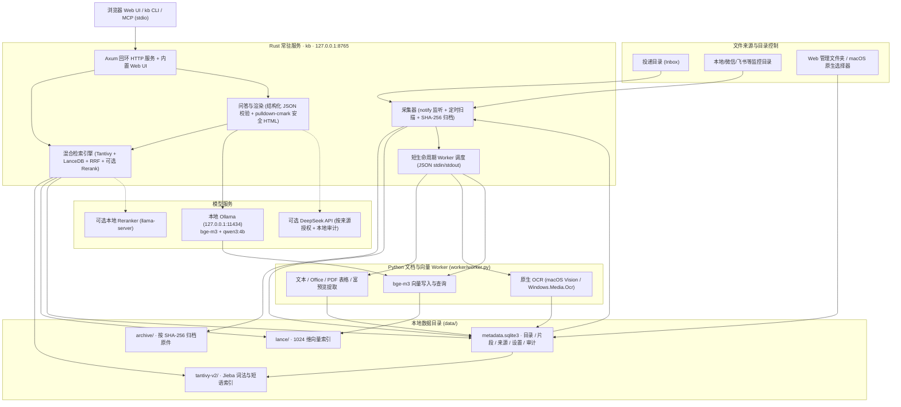

# 本地知识库 · Local Knowledge Base

> [English README](README.md) · **中文说明**

一个本地优先的原生 Rust 知识库服务：自动监听指定文件夹、按 SHA-256 对原文件去重归档，并通过浏览器界面、命令行（CLI）和 MCP（stdio）提供全文与语义混合检索及带原文出处的问答能力。

- **SQLite** 存储归档目录、片段正文、文件来源与云端审计日志
- **Tantivy + Jieba** 提供中文分词、精确短语和文件名优先的词法检索
- **LanceDB + Ollama (`bge-m3`)** 提供本地 1024 维向量语义检索
- **Ollama (`qwen3:4b`)** 生成结构化 Markdown 回答并附带可展开/可打开的原文出处（支持可选本地 Reranker 与按来源授权的 DeepSeek 回退）

---

## 核心特性

- **原生目录监听与内容去重归档**：结合系统文件事件通知（`notify`）与定时全量扫描，文件写入稳定后按 SHA-256 归档原件，源目录删除或重命名不影响已归档内容检索。
- **多格式文档解析与原生 OCR**：支持 PDF（含表格逐行索引与原页图片渲染）、Word（`.docx`）、Excel（`.xlsx`/`.xls`）、PowerPoint（`.pptx`）、Markdown、纯文本/日志、CSV/TSV、JSON、HTML、EPUB 及常见图片格式（macOS 使用 Apple Vision，Windows 使用 `Windows.Media.Ocr`）。
- **混合检索与精确匹配优先**：词法检索与向量检索通过 RRF 融合，严格保持「完整文件名 / 去扩展名匹配 > 连续短语匹配 > 常规匹配」优先级；支持可选本地 `llama-server` Reranker 重排。
- **内置单文件 Web 界面（零 Node.js 构建依赖）**：
  - **搜索 / 问答 / 归档文档**三标签工作台
  - **归档文档**按文件类型自动分组，展示来源、大小、归档时间、解析与向量化状态、SHA-256 与标签，支持类型筛选、关键字过滤与失败文件一键重试
  - 点击文件名可**直接从原位置打开文件**，也支持**打开所在位置**（Finder / 资源管理器）和**下载原文件**（归档副本）
  - **全格式在线富预览**：PDF 原页与可复制 Markdown 表格、图片 EXIF 校正预览与 OCR 文本、Excel/CSV/TSV 多工作表交互网格、PowerPoint 幻灯片卡片、Word/Markdown/HTML/EPUB 排版文档页、JSON/纯文本代码块
  - 顶部支持 **Figma / Miro** 双视觉风格即时切换（持久化至本地 SQLite 目录）
- **本地安全与可控云端策略**：HTTP 与本地模型接口强制绑定回环地址并校验 `Host`/`Origin`/CSP；可选 DeepSeek 回退默认关闭，需逐来源显式设置 `allow_cloud: true` 且每次请求前将完整请求体写入本地审计表。

---

## 系统架构

### 整体架构图



### 核心代码模块

| 目录 / 文件 | 职责说明 |
| --- | --- |
| `src/main.rs` | CLI 入口（`serve` / `search` / `ask` / `status` / `scan` / `reindex` / `mcp` / `set-key` / `audit`）与全局 `Runtime` 状态管理 |
| `src/server.rs` | 回环 Axum HTTP 服务、`Host`/`Origin`/CSP 安全中间件、内置静态资源路由、搜索/问答/归档/打开原文件/重试/预览等全部 API |
| `src/mcp.rs` | 基于 stdio 的 JSON-RPC 2.0 MCP 服务器，暴露 `kb_search` 与 `kb_ask`（兼容 `2025-11-25` 与 `2026-07-28` 协议） |
| `src/config.rs` | YAML 配置解析、热重载校验、平台差异路径（`macos`/`windows`/`linux`）、glob 过滤与回环地址校验 |
| `src/collector.rs` | `notify` 原生目录监听、定时全量扫描、写入稳定检查、SHA-256 去重归档及后台文档标注任务 |
| `src/folder_picker*` | macOS AppKit 原生文件夹选择器与安全作用域书签（`macos.m` / `Info.plist` / `build.rs`） |
| `src/store.rs` | SQLite WAL 模式目录与表结构、900 字符重叠切分（120 字符重叠）、归档元数据查询、原路径安全校验与云端审计 |
| `src/search.rs` | Tantivy（Jieba 搜索分词 + CJK 字符级短语索引 + 精确文件名字段）与 LanceDB RRF 混合召回 |
| `src/worker.rs`、`worker/` | Rust 与 Python（`python -I worker/worker.py`）隔离进程通信、文档/表格/幻灯片/图片预览、Apple Vision（`vision.swift`）与 Windows OCR、LanceDB 向量读写 |
| `src/models.rs`、`src/rerank.rs`、`src/markdown.rs` | Ollama 本地问答与 JSON Schema 校验、可选本地 Reranker、DeepSeek 逐来源权限校验与审计、`pulldown-cmark` 安全 HTML 渲染 |
| `web/` | 嵌入到 Rust 二进制中的原生 HTML / CSS / JS（支持 Figma & Miro 双主题、多格式在线预览与归档文档管理） |
| `scripts/`、`tests/smoke.py` | macOS `launchd` 与 Windows 任务计划开机自启脚本、基于合成文档的端到端冒烟测试 |

### 核心数据流

1. **采集与索引流水线**
   - 文件落入监控目录并写入稳定（`settle_seconds`）→ 计算 SHA-256 并在 `data/archive/<source>/<year>/<month>/<sha256>.<ext>` 去重存档 → 写入 SQLite `files` / `origins` / `observations`。
   - 后台按批次调用 `worker.py` 解析正文、识别扫描件/图片 OCR、回填 PDF 表格行 → 切分为带稳定引用 ID 的片段存入 SQLite `chunks` → 提交至 Tantivy 全文索引 → 按批次经 Ollama `bge-m3` 生成向量写入 LanceDB。
2. **检索与带引用问答流水线**
   - 查询同时触发 Tantivy 词法召回与 LanceDB 余弦相似度检索 → RRF 融合并按「精确文件名 > 连续短语 > 普通匹配」排序 → 若配置了本地 Reranker 则对前 30 条候选加权重排。
   - 问答取最多 10 条证据片段（单文件最多 3 条）发送给本地 Ollama，校验结构化 JSON 输出与引用编号，并由服务端安全渲染为 HTML 返回前端。

### 本地数据目录结构

```text
data/
  inbox/                 默认手动投递目录
  archive/<source>/<year>/<month>/<sha256>.<ext>
  metadata.sqlite3       归档目录、片段正文、来源记录、UI 设置与云端审计
  tantivy-v2/            Tantivy 词法与精确短语索引
  lance/                 LanceDB bge-m3 向量索引
```

---

## 环境准备与部署指南

### 1. 前置依赖

仓库严格锁定了工具链与依赖版本，建议在每台设备上独立克隆并重建 `.venv/` 与 `target/`：

- **Rust `1.100.0`**（通过 `rustup` 安装，[`rust-toolchain.toml`](rust-toolchain.toml) 会自动选择并附带 `rustfmt` 与 `clippy`；依赖锁定在 [`Cargo.lock`](Cargo.lock)）
- **uv `0.10.11`**（[`pyproject.toml`](pyproject.toml) 锁定版本；独立安装可使用 `uv self update 0.10.11`）与 **Python `3.12.9`**（由 [`.python-version`](.python-version) 指定，`uv sync --locked` 可自动拉取）
- **系统编译与 OCR 依赖**：
  - **macOS**：安装 Xcode Command Line Tools（`xcode-select --install`），用于 Objective-C 编译及 Apple Vision OCR
  - **Windows**：安装 Visual Studio C++ Build Tools 与 Windows SDK（使用 Rust MSVC 工具链），并在 **设置 → 时间和语言 → 语言和区域** 安装所需 OCR 语言包
  - **Linux**：安装 C/C++ 编译器、链接器与 `pkg-config`（Linux 暂不支持原生 OCR 与系统密钥链）
- **Ollama `0.40.17`**：用于本地向量化与大模型问答（仅构建和运行 Rust 单元测试时可不依赖 Ollama）

### 2. 克隆、构建与前台运行

```sh
gh repo clone Wayne-Shen/local-knowledge-base
cd local-knowledge-base
```

**macOS / Linux：**

```sh
uv sync --locked
cargo build --locked --release
test -e config.yaml || cp config.example.yaml config.yaml
./target/release/kb --version
```

**Windows (PowerShell)：**

```powershell
uv sync --locked
cargo build --locked --release
if (-not (Test-Path config.yaml)) { Copy-Item config.example.yaml config.yaml }
.\target\release\kb.exe --version
```

启动 Ollama 应用或运行 `ollama serve`，拉取本地模型：

```sh
ollama pull bge-m3
ollama pull qwen3:4b
```

启动服务：

```sh
# macOS / Linux
./target/release/kb serve

# Windows
.\target\release\kb.exe serve
```

浏览器打开 `http://127.0.0.1:8765`（若 `8765` 端口被占用，请在本地 `config.yaml` 中修改 `port`）。将任意文件复制到 `data/inbox/` 即可开始自动归档与索引。

### 3. 本地配置与凭证

- 复制 [`config.example.yaml`](config.example.yaml) 为 `config.yaml`（已被 `.gitignore` 忽略），按本机路径编辑 `data_dir`、`port`、`sources`、`models` 和 `schedule`。
- 支持通过 `--config PATH` 或环境变量 `KB_CONFIG`（见 [`.env.example`](.env.example)）指定配置文件路径。配置文件内的相对路径均以配置文件所在目录为基准解析，`~` 会展开为用户主目录。
- `sources` 支持 `inbox`、`wechat`、`feishu` 预设与自定义目录（递归扫描，支持 `include`/`exclude` glob）。除 `data_dir` 与 `port` 外，修改配置文件会在后台自动热重载。
- 若启用可选本地 Reranker，请在 `config.yaml` 中配置回环 `models.reranker.url`（如 `http://127.0.0.1:8766`）及位于被忽略目录 `.secrets/` 下的 `api_key_file`。
- 若启用可选 DeepSeek 回退：执行 `kb set-key` 将密钥存入 macOS 钥匙串或 Windows 凭据管理器，在 `config.yaml` 中开启 `models.fallback.enabled: true`，并在允许上云的来源上显式设置 `allow_cloud: true`。

### 4. 部署为开机自启后台服务

安装后台登录服务前，请先停止前台运行的 `kb serve`。

| 平台 | 安装并启动 | 查看状态 | 卸载服务（保留数据） |
| --- | --- | --- | --- |
| **macOS (`launchd`)** | `./scripts/launchd.sh install` | `./scripts/launchd.sh status` | `./scripts/launchd.sh remove` |
| **Windows (任务计划)** | `.\scripts\scheduled-task.ps1 Install` | `.\scripts\scheduled-task.ps1 Status` | `.\scripts\scheduled-task.ps1 Remove` |

- **macOS 说明**：脚本会将编译产物、`worker/` 与 `.venv/` 原子化发布到 `~/Library/Application Support/local-knowledge-base/current/`；首次安装会在 `~/Library/Application Support/local-knowledge-base/config.yaml` 创建默认配置，日志输出至 `~/Library/Logs/LocalKnowledgeBase/kb.log`。后续代码更新后，只需重新执行 `cargo build --locked --release` 和 `./scripts/launchd.sh install` 即可平滑升级且保留现有配置与数据。
- **macOS 权限提示**：微信等受保护目录请通过 Web 界面的 **管理文件夹 → 在 Mac 上选择文件夹** 授权，系统会保存安全作用域书签；若权限失效，重新选择即可恢复。
- **双环境并存提示**：若本机已运行 `launchd` 后台服务（默认占用 `8765`），在开发目录调试前台 `kb serve` 时请使用不同端口，或先暂停登录服务。

---

## 如何复用与集成

### 1. 命令行工具（CLI）

在 `kb serve` 运行时，可直接从终端检索、提问或运维（跨目录调用请加 `--config PATH` 或设置 `KB_CONFIG`）：

```sh
./target/release/kb search "中文分词"
./target/release/kb search --keyword-only "exact phrase"
./target/release/kb search --json "季度汇报"
./target/release/kb ask "这个项目的主要风险是什么？"
./target/release/kb ask --cloud "总结合同关键条款"
./target/release/kb status
./target/release/kb scan       # 触发全量扫描并重试失败任务
./target/release/kb reindex    # 从 SQLite 片段重建 Tantivy 与 LanceDB 索引（保留原件与引用 ID）
./target/release/kb audit --limit 20
```

### 2. 接入 AI 客户端（MCP over stdio）

服务运行后，可将 `kb mcp` 注册为标准 stdio MCP 服务器（提供 `kb_search` 与 `kb_ask` 两个工具，支持 MCP `2025-11-25` 和 `2026-07-28` 协议）：

```json
{
  "mcpServers": {
    "kb": {
      "command": "/绝对路径/local-knowledge-base/target/release/kb",
      "args": ["--config", "/绝对路径/local-knowledge-base/config.yaml", "mcp"]
    }
  }
}
```

### 3. 本地 HTTP API 复用

所有端点仅监听 `127.0.0.1:<port>`，POST 请求需携带 `Content-Type: application/json`，且拒绝跨源 `Origin` 请求：

| 端点 | 方法 | 用途 |
| --- | --- | --- |
| `/api/status` | `GET` | 获取归档/解析/失败/向量统计、扫描进度、错误列表与当前 UI 主题 |
| `/api/search` | `POST` | 混合或纯关键词检索（`{"query", "limit", "keyword_only"}`） |
| `/api/ask` | `POST` | 带引用与安全 HTML 渲染的问答（`{"question", "cloud", "keyword_only"}`） |
| `/api/archive` | `GET` | 获取全部归档文档元数据、来源标签、片段/向量计数与解析状态 |
| `/api/open` | `POST` | 按 SHA-256 从原位置调用系统默认应用打开文件或定位所在文件夹（`{"hash", "reveal"}`） |
| `/api/retry` | `POST` | 重试单个（`{"hash"}`）或全部失败文件的解析与表格提取 |
| `/api/folders`、`/api/folders/pick` | `GET`/`POST` | 查询、动态增删监控文件夹，或唤起 macOS 原生文件夹选择器 |
| `/api/theme` | `POST` | 切换并持久化 Web 主题（`{"theme": "figma" \| "miro"}`） |
| `/api/scan`、`/api/reindex` | `POST` | 触发后台全量扫描或双索引重建 |
| `/original/{hash}` | `GET` | 下载 SHA-256 归档原文件 |
| `/preview/{hash}/{page}`、`/preview/{hash}/{page}/tables` | `GET` | 获取 PDF 指定页 PNG 渲染图及可复制表格数据 |
| `/preview/{hash}/image`、`/preview/{hash}/document` | `GET` | 获取图片 PNG 预览及 Office/Markdown/CSV/JSON/文本等结构化预览 |

### 4. 跨设备迁移与备份复用

1. **备份数据**：先停止 `kb` 服务，再整体备份 `data/` 目录（内含 `archive/`、`metadata.sqlite3`、`tantivy-v2/`、`lance/`）。切勿将 `data/`、`config.yaml`、`.secrets/` 或密钥提交到 Git。
2. **新设备恢复**：在新设备上克隆仓库，执行 `uv sync --locked` 与 `cargo build --locked --release`，恢复 `data/` 并编写本机 `config.yaml`。
3. **模型摘要一致性**：若新设备上 Ollama 的 `bge-m3:latest` 摘要（digest）与原索引不一致（参考 [`HANDOFF.md`](HANDOFF.md) 中记录的验证摘要），请执行 `kb reindex` 重建向量索引；macOS 安全作用域目录与系统密钥链凭证需在新设备上重新授权。

---

## 验证与二次开发

修改代码后，在仓库根目录运行完整验证流程（`tests/smoke.py` 会自动创建临时目录并绑定随机空闲回环端口，不会影响本机正在运行的生产数据）：

```sh
cargo fmt --check
cargo build --locked --release
cargo test --locked --release
uv run --locked python -m compileall -q worker tests
node --check web/app.js
sh -n scripts/launchd.sh
uv run --locked python tests/smoke.py
```

协作与交接规范请参阅 [`agent.md`](agent.md)（架构边界、编码约定与强制收尾流程）和 [`HANDOFF.md`](HANDOFF.md)（当前验证状态、已完成工作与下一步计划）。
